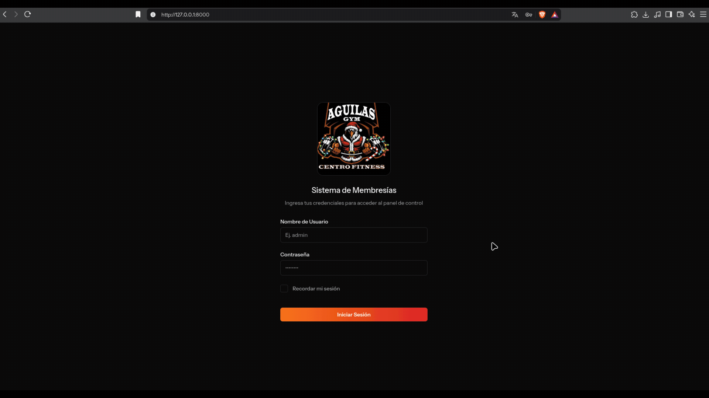
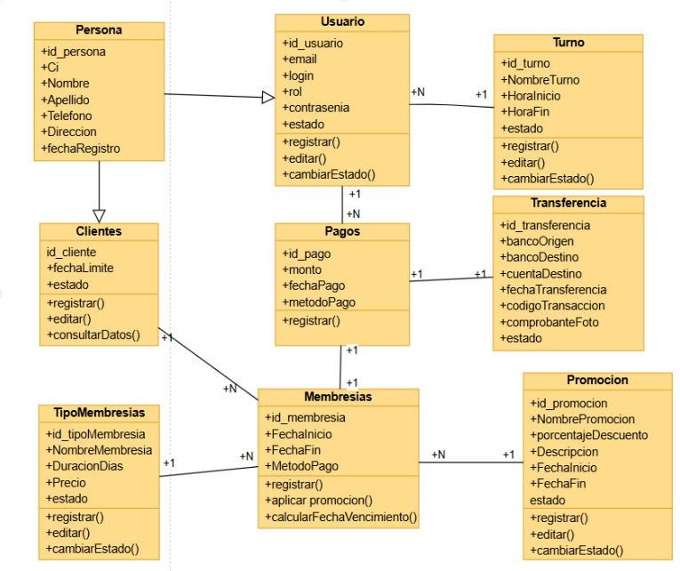
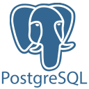
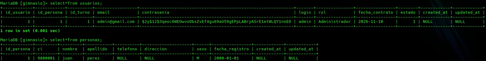

<h1 id="descripcionA"> Sistema De Gestion Para El Gimnasio Aguilas </h1>

Sistema web para la gestion del Gimnasio Aguilas, desarrollado como proyecto de la materia **Sistemas de Información 2 (INF-412)**. ***Permite administrar y automatizar los procesos administrativos relacionados con el registro de clientes, gestion de membresias, control de pagos y generacion de reportes financieros, y backups de seguridad***.

### Proyecto compilado


<h2 id="integrantesA">Integrantes del proyecto:</h2>

- Benjamin.

- Carlos.

- Juan.

## Informacion directa
- [Instalacion](#InstalacionA)
- [Descripcion breve](#descripcionA)
- [modulos](#modulosA)
- [stack Tegnologico](#tegnologiaA)
- [Modelo de base de datos](#basededatosA)
- [tipos de Roles](#rolesA)
- [tu primer usuario](#usuarioA)


<h2 id="modulosA">Caracteristicas principales(modulos)</h2>

*El sistema permite administrar los principales procesos del gimnasio mediante diferentes modulos*

- Gestion de clientes: Registro, modificación, consulta y administración de clientes.
- Gestion de membresias: Registro de nuevas membresias, renovacion y control de fechas de vencimiento.
- Gestion de pagos: Registro de pagos mediante efectivo y transferencias QR, incluyendo el almacenamiento de comprobantes.
- Gestion de tipos de membresias: Administración de planes, precios y duracion de las membresias.
- Gestion de promociones: Administracion de descuentos y promociones
- Gestion de turnos: Configuracion y administracion de los horarios disponibles.
- Gestion de usuarios: Registro, modificacion y control de acceso de los usuarios del sistema.
- Generacion de reportes: Consultas e informes relacionados con clientes, membresias e ingresos.
- Gestion de copias de seguridad: Generacion y restauracion de respaldos de la base de datos (backups).

<h2 id="tegnologiaA">Stack Tecnológico usado</h2>


| Capa | Tecnología |
|------|-----------|
| **Backend** | PHP 8.3, Laravel 12 |
| **Frontend** | Vue.js, JavaScript |
| **Estilos** | HTML5, CSS3, Tailwind CSS |
| **Base de Datos** | MySQL / PostgreSQL |
 **Arquitectura** | MVC (Modelo-Vista-Controlador) |
| **Autenticación** | Laravel Fortify + sistema de roles personalizado |
| **Build Tool** | Vite,  |
| **Servidor Web** | Apache 2.4 |
| **Gestor de dependencias Backend** | Composer |
| **Gestor de dependencias Frontend** | npm |

--------------------------------------------------------------------------------
<h2 id="arquitecturaA">Arquitectura General</h2>
El sistema utiliza una arquitectura web de tres capas, organizada mediante el patron Modelo-Vista-Controlador (MVC) proporcionado por Laravel.

1. **Capa de Presentacion:** Encargada de proporcionar las interfaces graficas con las que interactuan los usuarios.

**Tecnologias utilizadas:** Vue.js, Inertia.js, HTML5, CSS3, JavaScript, Tailwind CSS.

2.  **Capa de Negocio:** Encargada de procesar las solicitudes, aplicar las reglas de negocio y controlar las operaciones del sistema.

**Componentes principales:** Controllers, Models, Middleware, Validaciones, Sistema de autenticacion y autorizacion.

3. **Capa de Datos:** Encargada del almacenamiento, administracion y recuperación de la informacion.

**Tecnologias utilizadas:** PostgreSQL, Eloquent ORM, Migraciones de Laravel, Relaciones mediante claves primarias y foraneas.

<h2 id="rolesA">Roles del Sistema</h2>
El sistema cuenta con **2 roles**

#### 1. ADMINISTRADOR 
Usuario encargado de administrar y controlar el funcionamiento general del sistema.
- Gestion completa de clientes.
- Gestion de membresias.
- Administracion de tipos de membresias.
- Gestion de promociones y descuentos.
- Administracion de turnos.
- Gestion de usuarios del sistema.
- Consulta y generación de reportes.
- Gestion de copias de seguridad y restauracion de la base de datos.
- Control de las operaciones administrativas.

#### 2. RECEPCIONISTA
Usuario encargado de realizar las operaciones cotidianas de atencion al cliente y administración de membresias.

- Registro de nuevos clientes.
- Consulta y modificacion de informacion de clientes.
- Registro de nuevas membresias.
- Renovación de membresias.
- Registro de pagos.
- Consulta de informacion relacionada con clientes y membresias.
- Generacion de reportes segun los permisos asignados.
--------------------------------------------------------------------------------

## Modelo de Base de Datos relacional (9 tablas)

### Tablas principales
- **persona (informacion general)**.
- **usuario (roles)**.


<h2 id="basededatosA">tabla de base de datos relacional: </h2> 



---
<h2 id="InstalacionA">Instalación Y Configuración local en diferentes Sistemas Operativos:</h2>
recuerda actualizar sus paquetes antes, para evitar errores al momento de la instalacion.

```bash
#dentro del proyecto (cd BecaComedor)
php --ini                                       #para buscar el php.ini descomenta la bd que usaras
composer install                                #instalar composer
#composer update --ignore-platform-reqs         #(si da error el composer install)
npm install @vitejs/plugin-vue --save-dev       #instalar vue
cp .env.example .env                            #crear el .env y configuralo
php artisan key:generate                        #genera la clave de aplicacion de Laravel
php artisan migrate                             #migrar las tablas a la bd  

php artisan serve        #(terminal 1)          #Iniciar el servidor
npm run dev              #(terminal 2)          #levanta Frontend Vue/Vite
```

<h3  style="color: blue; font-size: 50px">Instalacion en Windows: </h3> 

```bash
# 1. Clonar el repositorio
git clone https://github.com/JEBUS-EL-GRANDE/BecaComedor.git
cd BecaComedor
#busca y descarga php (.zip) de la web oficial y composer e instalalos
```
<h3>instalacion en Arch linux: </h3>

```bash
sudo pacman -S php                              #instalar php
sudo pacman -S composer                         #instalar composer
sudo pacman -S nodejs npm                       #instalar npm
```

<h3> Instalacion en debian: </h3>

```bash
sudo apt install php php-cli php-mysql php-mbstring php-xml php-curl php-zip
sudo apt install composer                       #Instalar Composer
sudo apt install nodejs npm -y                  #instala npm
```
--------------------------------------------------------------------------------
<h3 id="usuarioA"> crea usuario admin en tu BASE DE DATOS :     </h3>
con este primer usuario podras crear al resto de usuarios que tienen roles:



**Tabla personas:**
```bash
INSERT INTO personas (ci,nombre, apellido,sexo, fecha_registro) 
VALUES ('9800001', 'juan', 'perez', 'M', '2000-01-01');
```
**Tabla turnos:**
```bash
INSERT INTO turnos (nombre_turno, hora_inicio, hora_fin) 
VALUES ('mediodia', '08:00:00', '17:00:00');
```
**Tabla usuarios:**
```bash
INSERT INTO usuarios (id_persona,id_turno,email,contrasenia,login,rol,fecha_contrato,estado)VALUES (1,'1','admin@gmail.com','$2y$12$3qeoc6WEOwvoObsZvEf4gu69aU59gEPpLABryASrE1etWLQY1noEO','admin','Administrador',NOW(),1);
```
con esto podras acceder al proyecto, solo pon en el login **"admin"**   y la contraseña es **"12345678"** que viene siendo la contraseña encriptada que pusiste de la tabla **usuarios**
